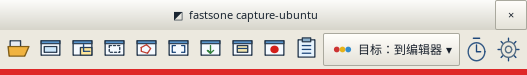
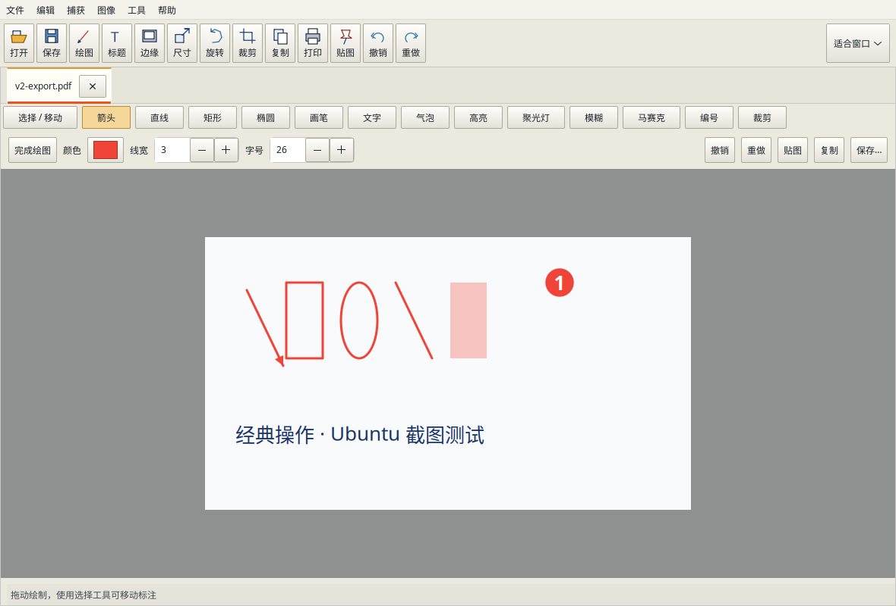

# fastsone capture-ubuntu

**本项目由作者独立开发，非 FastStone 官方产品。** 操作方式参考了 FastStone Capture。

Ubuntu 桌面上的截图、标注、滚动长图、录屏和本地中英文识字工具。按 **F3** 框选一张图，按 **F4** 框选一段文字。截图可以直接进编辑器、剪贴板或指定文件夹，识别出的文字可以直接粘贴。



## 安装与启动

已验证的环境为 **Ubuntu 24.04、x86_64、X11（Xorg）、系统 Python 3.12**。运行 `echo "$XDG_SESSION_TYPE"` 可以查看当前会话类型。如果显示 `wayland`，请在登录界面的齿轮菜单选择 **Ubuntu on Xorg** 后登录。

**1. 安装依赖。** GTK 用来显示桌面界面，GStreamer 用来录像，Tesseract 和中英文语言包用来识字。

```sh
sudo apt update
sudo apt install git copyq python3-gi python3-gi-cairo python3-cairo python3-pil \
  gir1.2-gtk-3.0 libxtst6 gir1.2-gstreamer-1.0 gstreamer1.0-x \
  gstreamer1.0-plugins-base gstreamer1.0-plugins-good gstreamer1.0-pulseaudio \
  tesseract-ocr tesseract-ocr-chi-sim tesseract-ocr-eng
```

**2. 下载并安装程序。** 在终端执行以下命令。如果使用发行页的 ZIP，解压后在项目目录执行最后一行即可。[下载发行版](https://github.com/zdc852636-code/fastsone-capture-ubuntu/releases/latest)

```sh
git clone https://github.com/zdc852636-code/fastsone-capture-ubuntu.git
cd fastsone-capture-ubuntu
/usr/bin/python3 install.py
```

安装程序使用当前用户的个人目录，首次安装后会打开悬浮工具栏，并添加应用菜单入口和登录自启。以后可在应用菜单搜索 **fastsone capture-ubuntu**。自启开关在工具栏齿轮菜单里。

## 第一次截图和识字

| 我想做什么 | 操作方法 |
| --- | --- |
| 截图发给别人 | 在工具栏的「目标」菜单选「到剪贴板」，按 **F3** 框选，松开鼠标后到聊天框按 **Ctrl+V**。 |
| 连续存几张图 | 在「目标」中选「选择目标文件夹…」。接下来的截图会以带时间的 PNG 文件名保存到该目录。 |
| 给截图圈重点 | 将目标设为「到编辑器」，截图后点击「绘图」。拖动画箭头或矩形，单击添加文字或编号。完成后按 **Ctrl+S** 保存。 |
| 复制屏幕上的文字 | 按 **F4**，框选文字，等到「文字已复制」提示后按 **Ctrl+V**。按 **Esc** 可以取消框选。 |

截图目标还可以选「到文件…」「到绘图」或「到打印机…」。「到文件…」会逐张询问保存位置，适合每张图需要单独命名的情况。

## 剪贴板历史

点击悬浮工具栏的 **剪贴板历史** 图标，或从编辑器的 **工具 → 剪贴板历史** 打开。窗口列出最近 100 条，可搜索文字预览、查看图片缩略图。按回车、双击或点击「复制选中项」，再回到目标应用按 **Ctrl+V** 粘贴。按 Esc 关闭窗口。

历史由本机 CopyQ 保存，Capture 启动时连接记录服务。新安装使用 100 条存储上限，继续复制时从列表末尾淘汰旧记录。如果已有标签超过 100 条，窗口提供「设置 100 条上限」按钮。CopyQ 的这个设置对每个标签页生效。

想用 **Win+V** 打开时，可在 Capture 的快捷键设置中给「剪贴板历史」填写 `Super+V`。已经通过桌面系统绑定该组合键的用户，也可把现有自定义快捷键的命令指向已安装的 `capture.py --clipboard-history`（使用 `/usr/bin/python3` 启动）。再次调用会关闭同一个历史窗口。

已配置微信输入法文本同步的电脑，可以在窗口底部查看同步状态。手机传来的纯文本和 F4 识别结果都会通过系统剪贴板进入历史。重新复制历史文字后，已有同步服务可将它发往关联设备。图片保存在本机，可在 Capture 窗口预览和复制。

## 编辑、缩放与导出



每张图都会打开成单独的标签。按住 **Ctrl** 滚动滚轮，可以围绕指针位置放大或缩小，范围为 **10% 至 800%**。右上角选择「适合窗口」可重新看整张图。

- **标注**支持箭头、线条、矩形、椭圆、画笔、文字、气泡、高亮、模糊、马赛克和编号。用「选择／移动」调整已有标注，**Ctrl+Z** 撤销，**Ctrl+Shift+Z** 重做。
- **图像处理**包括裁剪、调整尺寸、旋转、翻转、灰度、标题和边框。「贴图」能把参考图固定在其他窗口上方。
- **导出**时在文件名中指定扩展名。支持 PNG、JPEG、BMP、TIFF、WebP 和 PDF。保存后标注会合并进图像，需要继续移动标注时可保留编辑标签。

## 滚动长截图与屏幕录像

**滚动长截图**适合聊天记录、文档正文等可连续向下滚动的内容。

1. 点击工具栏的「滚动窗口」，只框选会移动的正文区域，把固定页眉、侧栏和滚动条留在框外。
2. 点击「开始滚动」，让程序自动滚动并匹配前后画面的重叠部分。
3. 到底会自动完成，也能在控制窗口点击「完成」提前收图。较长文档可分段截取。滚动达到 35 帧或累计高度达到 24000 像素时，程序会结束本次拼接。

**屏幕录像**支持全屏或矩形区域，输出 **WebM（VP8，15 FPS）**。打开工具栏的录像机，选择是否录制麦克风或系统声音，指定文件后开始。录制期间可以暂停、继续，最后点击「停止并保存」，等待保存完成。可用音源取决于桌面音频设备。

## 本地 OCR

F4 使用本机的 Tesseract 识别简体中文和英文。框选区域通过内存传入识别引擎，结果直接进入剪贴板。对于分栏清楚的双栏文字，程序按左栏、右栏的顺序输出。小字号、相似字形以及编号中的 `O/0` 容易混淆，复制金额和编号后建议核对原图。

如需提高疑难文字的识别质量，可在源码目录执行以下命令，下载约 28 MB 的官方中英文复查模型。安装工具会验证 SHA-256，Capture 在识别不确定时使用这些模型。

```sh
/usr/bin/python3 tools/install_ocr_models.py
```

## 快捷键和工具栏布局

| 默认按键 | 用途 |
| --- | --- |
| **F3** 或 **Ctrl+Alt+A** | 框选矩形区域截图 |
| **F4** | 框选识字并复制 |
| **Ctrl+Alt+F** / **Ctrl+Alt+W** | 捕获全屏 / 活动窗口 |
| **Ctrl+Alt+R** | 打开录像机或停止当前录像 |
| **Ctrl+滚轮** | 在编辑器中缩放当前图片 |
| **Ctrl+S** / **Ctrl+Shift+S** | 保存 / 另存为 |
| **Ctrl+C** / **Ctrl+V** | 在编辑器中复制图片 / 从剪贴板导入图片 |

在 **设置 → 快捷键** 中输入新按键，例如 `F8` 或 `Ctrl+Alt+K`，点击「应用」即可使用。清空一项可停用该快捷键。如果按键已被其他程序占用，设置窗口会提示更换。

在 **设置 → 图标布局** 中选择悬浮工具栏或编辑器工具栏，拖动条目或用「上移／下移」调整顺序，勾选需要显示的工具。两个工具栏可以分别恢复默认布局。

## 常见问题

**启动后找不到工具栏？** 将鼠标移到屏幕顶部的短红条上。工具栏闲置后会收起，移入红条即可展开，收起时仍可使用截图快捷键。

**截图后没有弹出编辑器？** 展开工具栏查看「目标」。选择「到编辑器」后，下一张截图会打开成新的编辑标签。已有标签可通过齿轮菜单的「显示编辑器」找回。

**F4 提示缺少识别组件或语言包？** 系统安装的 Tesseract 可用 `tesseract --list-langs` 检查。列表应包含 `chi_sim` 和 `eng`，缺少时安装上面的语言包。识别失败或取消框选时会保留原剪贴板内容。

**如何升级？** 通过 Git 下载的用户可以在项目目录执行 `git pull --ff-only`，然后重新运行 `/usr/bin/python3 install.py`。正在编辑的截图可先保存，从工具栏退出，再打开新版。旧版升级会沿用原配置、快捷键、OCR 模型位置和自启选择。

## 项目与许可

开发者可以使用独立测试桌面验证截图、输入和编辑流程，也可以用附带的合成样例复测 OCR。完整操作、卸载步骤及测试命令见 [使用说明](README.txt) 和 [测试说明](tests/README.txt)。

源码采用 [MIT 许可](LICENSE)。个人离线包可附带 Ubuntu 的 Cairo 适配组件，许可见 [组件声明](vendor/COPYRIGHT-gi-cairo)。可选 OCR 模型使用 Apache-2.0 许可，安装后可在模型目录查看来源和许可文件。
